<div align="center">

# 🔦 던전 개척자 (Dungeon Pioneer)

**3D 던전 탐험 액션 · 팀 프로젝트 · 개발 중**

*횃불로 어둠을 밝히며 던전을 **개척**해보자!*

[](https://unity.com/)
[](#)
[](#)
[](#)

<!-- TODO: 영상 업로드 후 아래 링크를 watch URL로 교체 -->
[▶ 포트폴리오 영상 (YouTube)](https://www.youtube.com/channel/UCMoIuWbEUPRG-8-CIZpd6cQ) · [🌐 포트폴리오 사이트](https://chlwnsdud2025.github.io/projects/dungeon-pioneer.html) · [📑 Canva 포트폴리오](https://www.canva.com/d/mzu8Fvwvj8IVG7d)

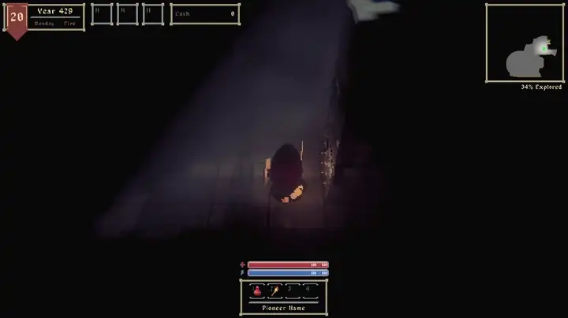 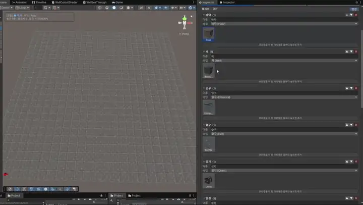

<sub>왼쪽: 벽 면에 횃불을 걸어 길을 밝히고 미니맵을 채움 · 오른쪽: 직접 만들어 팀원에게 제공한 맵 빌더 에디터 툴</sub>

</div>

<br>

## 📌 프로젝트 개요

| 항목 | 내용 |
| --- | --- |
| **장르** | 3D 던전 탐험 액션 (탑다운 쿼터뷰) |
| **개발 형태** | 팀 프로젝트 (3인 — 개발 · 기획 · 아트) |
| **맡은 역할** | **메인 개발** — 횃불 · 적 AI · 던전 · 미니맵 · 전투 · UI, **맵 빌더 에디터 툴** |
| **개발 기간** | 2026.06.17 – 현재 (개발 중) |
| **개발 환경** | Unity 6 (6000.3.17f1), C#, URP, Input System |
| **커밋 기여** | 저장소 전체 183커밋 중 136커밋 직접 작성 (≈74%) |
| **목표** | 빛 하나가 탐색 · 전투 · 지도를 함께 움직이는 던전을 만들고, 팀원이 코드 없이 맵을 만들 수 있는 제작 환경을 갖추자 |

<br>

## 🎮 게임 소개

> 던전은 기본적으로 어둡습니다. 플레이어는 벽에 횃불을 걸어 길을 밝히고, 밝힌 곳만큼 지도가 채워지며 던전을 **"개척"** 합니다.
> 하지만 횃불에는 수명이 있고, 적은 플레이어뿐 아니라 **횃불을 노리고 꺼뜨립니다**. 빛이 탐색 자원이자 전투의 대상이 되는 구조입니다.

- **DARK** — 플레이어 주변만 보이고, 빛이 닿지 않은 곳은 지도에도 남지 않음
- **TORCH** — 벽의 원하는 면에 횃불을 걸면, 비춘 곳이 탐색한 곳으로 지도에 영구 기록
- **ENEMY** — 시야에 들어온 플레이어를 쫓고, 근처의 횃불을 때려 수명을 깎음
- **EXPLORE** — 미니맵에 밝힌 바닥의 비율(개척도)이 표시되어 진행의 지표가 됨

<table>
<tr>
<td width="50%"></td>
<td width="50%">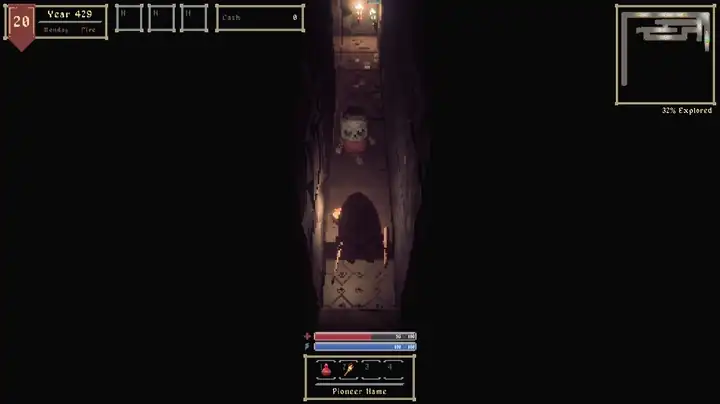</td>
</tr>
<tr>
<td align="center"><sub>던전 입장 — 손에 든 횃불이 닿는 범위만 보임</sub></td>
<td align="center"><sub>통로에서 마주친 적과 전투 — 피격 시 체력바 표시</sub></td>
</tr>
</table>

<br>

## 🙋 담당 구현 요약

| # | 구현 내용 | 핵심 키워드 |
| :-: | --- | --- |
| 1 | [횃불 시스템 — 수명이 있는 빛](#1-횃불-시스템--수명이-있는-빛과-적의-소등) | 벽 면 단위 설치 · 180초 수명 게이지 · 적의 공격 −60초 · 던전 재입장 시 복원 |
| 2 | [LocationGrid 기반 적 AI](#2-locationgrid-기반-적-ai--순찰-시야-횃불-사냥) | NavMesh → Grid A* 전환 · FOV 120° 감지 · 횃불 사냥과 포기 규칙 |
| 3 | [맵 빌더 에디터 툴](#3-맵-빌더-에디터-툴--기획--아트-팀원을-위한-제작-도구) | 팔레트 기반 배치 · 던전 / 필드 / 마을 굽기 · **기획 · 아트 팀원에게 제공** |
| 4 | [시야 기반 미니맵](#4-시야-기반-미니맵--빛과-탐색-상태를-그리는-지도) | 픽셀 단위 시야선 · 256칸 밝기표 · 변경 범위만 재칠하기 · 야외 지도 이미지 가공 |

---

## 1. 횃불 시스템 — 수명이 있는 빛과 적의 소등

> **탐색에 쓰는 빛이 설치 위치 · 시간 · 적의 공격에 따라 달라지도록, 벽 면 단위 설치와 수명 게이지를 구현**

<table>
<tr>
<td width="50%"></td>
<td width="50%">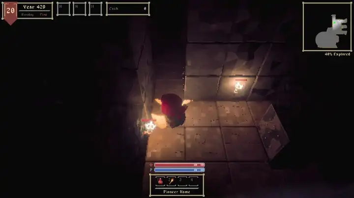</td>
</tr>
<tr>
<td align="center"><sub>벽 면에 횃불을 걸면 머리 위에 남은 수명 게이지 표시</sub></td>
<td align="center"><sub>횃불이 비춘 바닥은 미니맵에 탐색한 곳으로 남음</sub></td>
</tr>
</table>

| 구분 | 설계 | 내용 |
| --- | --- | --- |
| **설치** | 벽 면 단위 | 벽 콜라이더의 6방향 면 중 하나(`faceKey`)에 부착. 같은 면에는 중복 설치 불가, 다른 면에는 설치 가능 |
| | 설치 · 복원 규칙 공유 | 위치 · 회전 계산(`GetMountPose`)을 설치와 복원이 같은 함수로 사용 → 던전을 나갔다 와도 같은 자리에 복원 |
| | 함정 벽 | 함정이 숨은 벽에 설치를 시도하면 횃불 대신 함정이 발동 |
| **수명** | 기본 180초 | 남은 비율을 머리 위 게이지로 표시, 마지막 10초 동안 밝기 · 범위가 줄어듦 (범위는 최소 30% 유지) |
| | 적의 공격 | 피해량과 무관하게 **한 대에 60초 감소** → 세 번 맞으면 소멸 |
| | 누적값 없는 밝기 | 밝기를 매 프레임 남은 시간에서 계산 → 층을 다시 켜거나 복원한 첫 프레임부터 정확 |
| **연결** | 활성 횃불 목록 | 켜진 횃불만 정적 집합으로 관리 → 미니맵 광원과 적 AI의 탐지가 같은 목록을 사용 |
| | 던전 재입장 | 벽 칸 · 면 · 남은 시간을 기록(`ToRecord`)했다가, 다시 들어오면 같은 벽 면에 남은 시간으로 복원 |

```csharp
// TorchInstance.cs — 한 대에 60초를 깎고, 밝기는 남은 시간에서 파생
public void TakeDamage(float damage, Transform attacker)
{
    if (!IsAlive || damage <= 0f) return;

    expiresAt -= secondsPerHit;   // 피해량과 무관하게 한 대 = 60초
    ApplyFade();                  // 게이지 · 밝기에 바로 반영
}

private void ApplyFade()
{
    float t = fadeOutSeconds > 0f ? Mathf.Clamp01(Remaining / fadeOutSeconds) : 1f;
    torchLight.intensity = baseIntensity * t;
    torchLight.range     = baseRange * Mathf.Lerp(minRangeRatio, 1f, t);   // 불씨처럼 최소 범위 유지
}

// 설치와 복원이 같은 규칙을 써야 복원된 횃불이 처음 자리에 그대로 나온다
public static void GetMountPose(Collider wallCollider, Vector3Int faceKey, out Vector3 position, out Quaternion rotation)
{
    Vector3 normal = faceKey;
    Bounds bounds = wallCollider.bounds;
    position = bounds.center + Vector3.Scale(normal, bounds.extents);
    rotation = Quaternion.LookRotation(normal);
}
```

📂 **관련 코드** — [`TorchInstance.cs`](Project%20DP/Assets/Scripts/Map/TorchInstance.cs) · [`PlaceTorchState_Player.cs`](Project%20DP/Assets/Scripts/Player/State/PlaceTorchState_Player.cs) · [`TorchGauge.cs`](Project%20DP/Assets/Scripts/UI/Components/TorchGauge.cs) · [`WallObject.cs`](Project%20DP/Assets/Scripts/Map/WallObject.cs) · [`DungeonManager.cs`](Project%20DP/Assets/Scripts/Core/DungeonManager.cs)

---

## 2. LocationGrid 기반 적 AI — 순찰, 시야, 횃불 사냥

> **타일 단위로 바뀌는 던전 구조에 맞춰 NavMesh에서 LocationGrid A* 이동으로 전환하고, FOV 감지와 횃불 사냥을 연결**

<table>
<tr>
<td width="50%">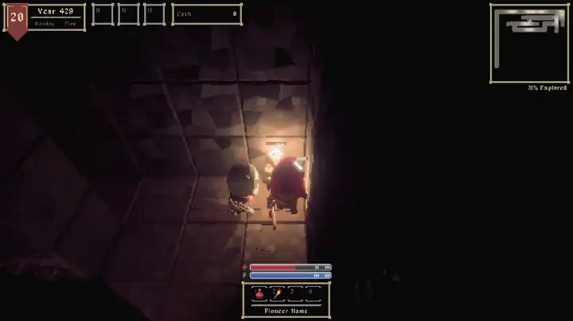</td>
<td width="50%"></td>
</tr>
<tr>
<td align="center"><sub>시야에 들어온 플레이어를 발견하고 접근</sub></td>
<td align="center"><sub>사거리 · 쿨타임 · FOV를 통과하면 공격, 피격 시 체력바 표시</sub></td>
</tr>
</table>

### 이동 — Grid A*

| 설계 | 내용 |
| --- | --- |
| **LocationGrid** | 층마다 바닥 · 벽 · 함정 구덩이 · 밀 수 있는 블록 같은 셀 정보를 만들고, 지형 · AI · 미니맵이 함께 사용 |
| **NavMesh에서 전환한 이유** | 밀 수 있는 블록이 칸을 막거나 구덩이가 메워지는 등 **칸 단위로 바뀌는 통행 정보**를 그대로 경로 탐색에 쓰기 위해 |
| **GridMover** | A* 경로를 따라가며 앞 6칸까지 직선으로 갈 수 있는지 검사해 모서리를 깎아 이동 |
| **재탐색 조건** | 추적 대상의 칸이 바뀌거나 0.5초가 지나면 재탐색, 0.5초 이상 제자리면 막힌 것으로 보고 재탐색 |
| **GridSearch** | 범위 탐색(BFS) 버퍼를 재사용해 순찰 지점 탐색 시 반복 할당을 줄임 |

### 감지 — FOV

| 규칙 | 내용 |
| --- | --- |
| **전방 시야** | 탐지 반경 안 + 전방 120° 안 + 벽에 막히지 않은 시야선이 모두 통과해야 발견 |
| **시야 밖 감지** | 시야 밖에서 **달려서** 접근하면 1/3 반경 안에서 반응해 경계(Alert) 상태로 전환 |
| **추격 유지** | 추격 중에는 FOV와 무관하게 반경의 1.5배까지 대상을 놓치지 않음 |
| **후방 공격** | 시야 밖에서 맞으면 받는 피해 1.5배 |

**적 FSM** — `Idle` · `Patrol` · `Alert` · `Chase` · `Attack` · `Hit` · `Dead`, 7개 상태가 같은 감지 · 이동 함수를 공유합니다.

### 횃불 사냥

적은 플레이어를 찾지 못했을 때 **시야 안에 들어온 횃불** 중, 횃불 앞 바닥 셀에 설 수 있는 가장 가까운 횃불을 목표로 삼습니다.
걸어가는 동안 모퉁이에 가려지는 건 정상이므로 시야 대신 **"갈 수 없게 됐는지"와 "도착했는데도 못 때리는지"** 만 보고, 3초 동안 공격하지 못하면 포기한 뒤 그 횃불을 10초 동안 무시합니다. 횃불을 노리던 중에도 플레이어를 발견하면 즉시 대상을 바꿉니다.

```csharp
// EnemyController.cs — 횃불 탐지: 시야 · 거리 · 접근 셀 · 포기 목록을 모두 통과한 가장 가까운 횃불
foreach (TorchInstance torch in TorchInstance.EnumerateActiveTorches())
{
    if (torch == null || !torch.IsAlive) continue;
    if (IsTargetIgnored(torch)) continue;                       // 최근에 포기한 횃불

    float distance = GetHorizontalDistanceTo(torch.transform.position);
    if (distance > detectionRadius || distance >= nearestDistance) continue;
    if (!IsInFieldOfView(torch.transform.position)) continue;
    if (!Grid.IsPassable(torch.ApproachCell, false)) continue;  // 횃불 앞 칸에 설 수 있어야 함
    if (!CanSeeTarget(torch)) continue;                         // 벽에서 살짝 띄운 AimPoint로 시야선 검사

    nearestDistance = distance;
    nearest = torch;
}
```

📂 **관련 코드** — [`EnemyController.cs`](Project%20DP/Assets/Scripts/Enemy/EnemyController.cs) · [`EnemyChaseState.cs`](Project%20DP/Assets/Scripts/Enemy/State/EnemyChaseState.cs) · [`LocationGrid.cs`](Project%20DP/Assets/Scripts/World/Grid/LocationGrid.cs) · [`GridMover.cs`](Project%20DP/Assets/Scripts/Actor/GridMover.cs) · [`GridSearch.cs`](Project%20DP/Assets/Scripts/Actor/GridSearch.cs) · [`AStarPathfinder.cs`](Project%20DP/Assets/Scripts/Pathfinding/AStarPathfinder.cs) · [`Perception.cs`](Project%20DP/Assets/Scripts/Actor/Perception.cs)

---

## 3. 맵 빌더 에디터 툴 — 기획 · 아트 팀원을 위한 제작 도구

> **기획 · 아트 팀원이 코드 없이 던전 · 필드 · 마을 맵을 만들 수 있도록, 팔레트 기반 배치와 맵 굽기를 제공하는 에디터 툴을 직접 만들어 제공**

<table>
<tr>
<td width="50%">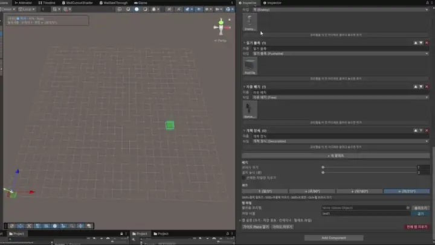</td>
<td width="50%"></td>
</tr>
<tr>
<td align="center"><sub>Shift+클릭으로 칠하고, Ctrl+휠로 브러시 크기(1~5) 조절</sub></td>
<td align="center"><sub>팔레트를 벽으로 바꾸고 설치 높이(층)를 지정해 벽 쌓기</sub></td>
</tr>
<tr>
<td width="50%">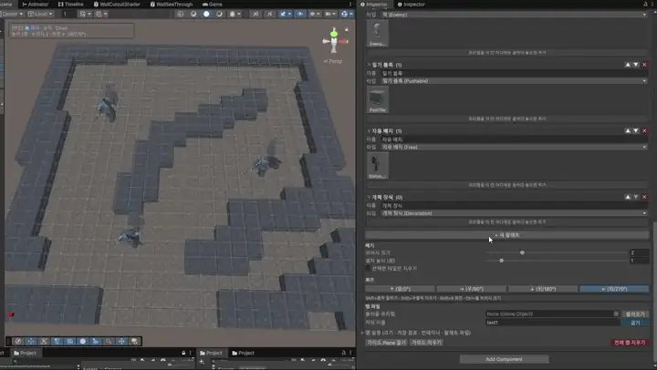</td>
<td width="50%">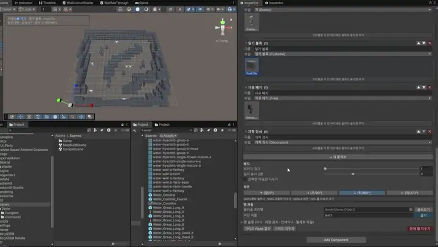</td>
</tr>
<tr>
<td align="center"><sub>상자 · 함정 · 적 · 입구 · 출구를 골라 배치, Shift+R로 회전</sub></td>
<td align="center"><sub>게임에 쓰이는 던전 맵을 불러와 이어서 편집</sub></td>
</tr>
</table>

#### 🔍 문제 상황
여러 던전 · 필드 · 마을의 타일과 환경 배치를 반복해서 만들어야 했고, 맵을 직접 만드는 사람은 **프로그래머가 아닌 기획 · 아트 팀원**이었습니다. 프리팹을 하나씩 씬에 놓고 좌표 · 회전 · 부모를 맞추는 방식으로는 제작 속도가 느리고, 게임 코드가 기대하는 구조(그리드 원점, 종류별 묶음, 씬 설정 컴포넌트)를 사람이 매번 지켜야 했습니다.

#### 🛠 해결 — 배치

| 기능 | 내용 |
| --- | --- |
| **맵 종류 탭** | 던전 · 필드 · 마을 탭을 고르면 그 종류에서 쓸 수 있는 팔레트 타입만 허용 (필드 · 마을은 바닥 · 벽 · 상자 · 적 · 자유 배치) → 쓸 수 없는 타입은 경고 표시 |
| **팔레트 파일** | 팔레트 목록을 ScriptableObject 에셋으로 저장해 Git으로 팀원과 공유. 프리팹을 팔레트 칸에 **끌어다 놓으면 바로 추가**되어 아트 에셋을 즉시 반영 |
| **브러시** | 격자 위 Shift+클릭 · 드래그로 연속 배치, Shift+우클릭 지우기, Ctrl+휠 브러시 크기, 설치 높이(층) 지정, "선택한 타일만 지우기" |
| **고스트 미리보기** | 놓기 전에 반투명 미리보기로 위치와 회전(Shift+R, 90° 단위)을 확인 |
| **자유 배치** | 석상 · 장식처럼 격자에 묶이지 않는 오브젝트는 마우스 위치에 하나씩 배치, Ctrl+휠로 높이 조절 |
| **씬 뷰 안내판** | 인스펙터를 보지 않아도 현재 맵 종류 · 팔레트 · 프리팹 · 높이 · 브러시 · 회전을 씬 뷰 왼쪽 위에 표시 |
| **Undo 한 단계** | 한 번의 붓질(마우스 누름 ~ 뗌)을 Undo 그룹 하나로 묶어 Ctrl+Z 한 번에 되돌림 |

#### 🛠 해결 — 굽기 · 협업 안전장치

| 기능 | 내용 |
| --- | --- |
| **맵 굽기** | 작업 컨테이너를 프리팹으로 저장. 필드 · 마을은 루트에 `SceneLocation`, 장애물 묶음에 `GridBlocker`를 자동으로 붙여 LocationGrid와 NPC 이동에 바로 반영 |
| **불러오기** | 기존 맵 프리팹을 풀어 다시 편집. 불러온 맵의 종류로 탭을 자동 전환하고, 오브젝트를 종류별 묶음으로 정리 |
| **덮어쓰기 경고** | 같은 이름의 맵이 있으면 "다른 팀원이 직접 수정했다면 사라진다"는 확인창 → 최신 버전을 불러왔는지 확인하게 함 |
| **참조 보존** | 덮어써도 루트 오브젝트 ID를 되돌려, 던전 씬이 들고 있는 맵 참조가 끊기지 않음 |
| **실수 방지** | Prefab Variant 맵은 불러오기를 막고 변환 메뉴를 안내, 필드 · 마을 바닥이 (0,0) 칸에서 시작하지 않으면 굽기 전에 경고 |

```csharp
// MapBuilderEditor.cs — 덮어써도 던전 씬의 맵 참조가 끊기지 않도록 루트 ID를 보존
GameObject existing = AssetDatabase.LoadAssetAtPath<GameObject>(fullPath);
long oldRootId = 0;
bool hasOldRootId = existing != null
    && AssetDatabase.TryGetGUIDAndLocalFileIdentifier(existing, out _, out oldRootId);
...
// 필드 · 마을은 SceneLocation + GridBlocker를 붙이고, 던전은 SceneLocation을 뗀다
MapBuilderContainers.ApplySceneSetup(builder.tileContainer, builder.mapKind);
PrefabUtility.SaveAsPrefabAsset(builder.tileContainer.gameObject, fullPath, out bool success);

if (hasOldRootId) MapPrefabMigration.RestoreRootFileId(fullPath, oldRootId);
```

<p align="center">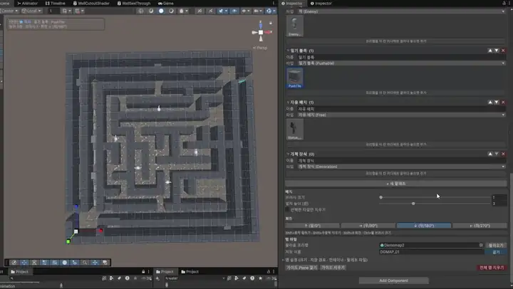<br><sub>필드 · 마을 맵도 전용 팔레트(잔디 · 모래 · 물 타일)로 같은 방식으로 제작</sub></p>

#### ✅ 결과
- **역할 분리** — 기획 팀원은 던전 · 필드 맵 레벨 디자인을, 아트 팀원은 타일 · 환경 에셋 등록과 배치를 툴 안에서 진행
- **게임 구조 자동 보장** — 그리드 원점 · 종류별 묶음 · 씬 설정 컴포넌트를 툴이 맞춰 주므로, 구운 맵이 바로 게임에서 동작
- **규모** — 에디터 확장 약 1,400줄 (`MapBuilderEditor.cs`) + 컨테이너 · 마이그레이션 유틸리티

📂 **관련 코드** — [`MapBuilderEditor.cs`](Project%20DP/Assets/Editor/MapBuilderEditor.cs) · [`MapBuilderContainers.cs`](Project%20DP/Assets/Editor/MapBuilderContainers.cs) · [`MapPrefabMigration.cs`](Project%20DP/Assets/Editor/MapPrefabMigration.cs) · [`MapBuilder.cs`](Project%20DP/Assets/Scripts/Map/Builder/MapBuilder.cs) · [`MapPaletteLibrary.cs`](Project%20DP/Assets/Scripts/Map/Builder/MapPaletteLibrary.cs) · [`LocationGridBuilder.cs`](Project%20DP/Assets/Scripts/World/Grid/LocationGridBuilder.cs)

---

## 4. 시야 기반 미니맵 — 빛과 탐색 상태를 그리는 지도

> **어둠 속 미탐색 영역과 광원으로 보이는 영역을 구분해 그리고, 바뀐 범위만 다시 칠해 전체 갱신 비용을 피함**

<table>
<tr>
<td width="50%"></td>
<td width="50%">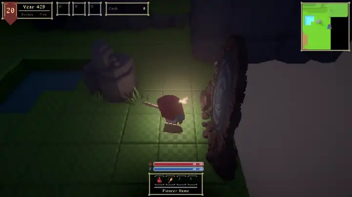</td>
</tr>
<tr>
<td align="center"><sub>던전 — 밝힌 바닥만 지도에 남고 탐색률(Explored %)이 올라감</sub></td>
<td align="center"><sub>필드 — 위에서 찍은 지형을 그림 같은 지도로 가공해 플레이어 중심으로 표시</sub></td>
</tr>
</table>

### 던전 미니맵

| 설계 | 내용 |
| --- | --- |
| **픽셀 단위 시야선** | 미니맵 픽셀마다 광원에서 격자를 따라가며(DDA) 벽 · 밀 수 있는 블록에 가려지는지 계산 |
| **밝기표** | 거리² 기준 256칸 감쇠표를 미리 만들어, 픽셀마다 제곱근 · 감쇠 계산 없이 표에서 밝기를 조회 |
| **횃불 겹침** | 여러 횃불이 겹치는 곳은 더 밝은 값을 사용, 꺼진 횃불의 빛은 빠지지만 탐색 기록은 남음 |
| **탐색 기록 · 개척도** | 빛이 닿은 바닥은 탐색한 곳으로 영구 기록하고, 탐색한 바닥 비율을 `Explored %`로 표시 |
| **부분 갱신** | 플레이어가 움직이면 **이전 밝힌 범위 ∪ 새 범위**만 다시 칠함 |
| **층별 기록** | 층을 떠날 때 탐색 기록을 저장했다가 다시 들어오면 복원 |

```csharp
// MinimapVisionMap.cs — 광원 범위 안 픽셀만 순회, 시야선이 통과하면 밝기표에서 조회
for (int y = y0; y <= y1; y++)
for (int x = x0; x <= x1; x++)
{
    int i = y * Width + x;
    if (kinds[i] == PixelKind.Solid) continue;

    float px = (x + 0.5f) * inv, py = (y + 0.5f) * inv;
    float dx = px - center.x, dy = py - center.y;
    float distanceSq = dx * dx + dy * dy;
    if (distanceSq > radiusSq) continue;

    bool endBlocked = IsBlocking(x / pixelsPerTile, y / pixelsPerTile);
    if (!CanSee(center.x, center.y, px, py, endBlocked)) continue;   // 격자 DDA 시야선

    byte light = falloff[(int)(distanceSq * toFalloffIndex)];        // 256칸 밝기표
    if (light > mask[i]) mask[i] = light;                             // 겹치면 밝은 쪽
}
```

### 야외 미니맵

필드처럼 넓은 야외 맵은 위에서 찍은 지형을 그대로 쓰면 텍스처 무늬가 지저분하게 보입니다.
맵을 **한 번만 촬영**한 뒤 **Kuwahara 필터**로 자잘한 무늬는 뭉개고 경계는 살리고, 색 보정 · 높이 기반 음영 · 그림자 · 외곽선을 더해 그림 같은 지도 이미지로 가공했습니다. 게임 중에는 이 이미지에서 플레이어 중심 영역만 잘라 표시합니다.

📂 **관련 코드** — [`MinimapVisionMap.cs`](Project%20DP/Assets/Scripts/Core/MinimapVisionMap.cs) · [`MinimapManager.cs`](Project%20DP/Assets/Scripts/Core/MinimapManager.cs) · [`MinimapImageProcessing.cs`](Project%20DP/Assets/Scripts/Core/MinimapImageProcessing.cs) · [`OutdoorMinimap.cs`](Project%20DP/Assets/Scripts/Core/OutdoorMinimap.cs) · [`TorchFOV.cs`](Project%20DP/Assets/Scripts/TorchFOV.cs)

---

## ➕ 그 외 구현

<table>
<tr>
<td width="50%">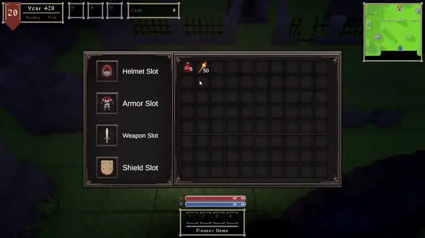</td>
<td width="50%">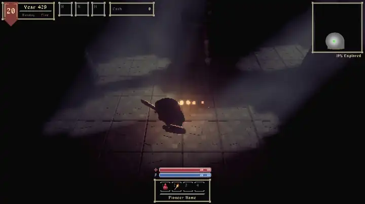</td>
</tr>
<tr>
<td align="center"><sub>그리드 인벤토리 — 드래그 시 배치 가능 칸은 초록, 불가능하면 빨강</sub></td>
<td align="center"><sub>카메라와 플레이어 사이를 가리는 벽은 반투명 처리</sub></td>
</tr>
<tr>
<td width="50%">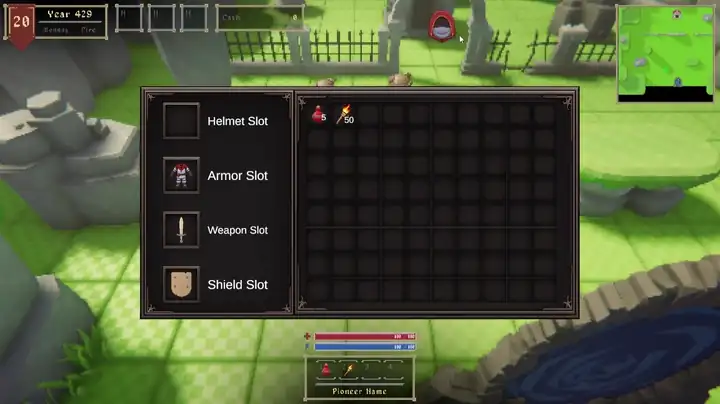</td>
<td width="50%">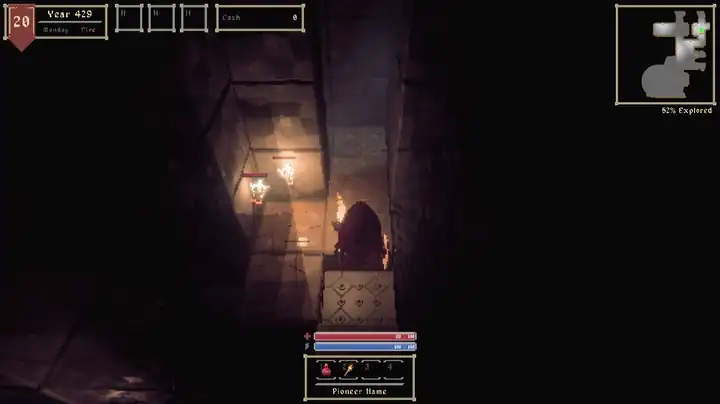</td>
</tr>
<tr>
<td align="center"><sub>포탈로 오버월드 ↔ 필드 이동 (페이드 연출 · 도착 지점 스폰)</sub></td>
<td align="center"><sub>계단을 밟으면 이동 모션과 페이드로 다음 층 진입, 미니맵은 층별 기록</sub></td>
</tr>
</table>

- **플레이어 FSM** — Idle · Walk · Run · Jump · Attack · Guard · Hit · Knockback · Push · OpenChest · PlaceTorch · StairTransition · Dead ([`PlayerStateMachine.cs`](Project%20DP/Assets/Scripts/Player/PlayerStateMachine.cs), [`PlayerController.cs`](Project%20DP/Assets/Scripts/Player/PlayerController.cs))
- **인벤토리 · 장비 · 퀵슬롯** — 그리드 인벤토리, 헬멧 · 갑옷 · 무기 · 방패 장착 시 캐릭터 모델 반영, 소비 아이템 퀵슬롯 ([`InventoryGrid.cs`](Project%20DP/Assets/Scripts/UI/Panels/Popup/InventoryGrid.cs), [`EquipmentHolder.cs`](Project%20DP/Assets/Scripts/Player/EquipmentHolder.cs), [`UIQuickSlotBar.cs`](Project%20DP/Assets/Scripts/UI/Panels/Scene/UIQuickSlotBar.cs))
- **던전 기믹** — 밀 수 있는 블록(구덩이를 메우면 바닥 높이에 맞춰 가라앉음), 화살 · 굴러오는 바위 · 벽 함정, 상자 ([`PushableObject.cs`](Project%20DP/Assets/Scripts/Map/PushableObject.cs), [`ArrowTrap.cs`](Project%20DP/Assets/Scripts/Map/ArrowTrap.cs), [`RollingRockTrap.cs`](Project%20DP/Assets/Scripts/Map/RollingRockTrap.cs))
- **지역 이동** — 장소 ID로 씬을 이동하는 `WorldManager.Travel`, 출발 · 도착을 함께 담당하는 포탈 ([`WorldManager.cs`](Project%20DP/Assets/Scripts/World/WorldManager.cs), [`LocationPortal.cs`](Project%20DP/Assets/Scripts/World/LocationPortal.cs))
- **벽 반투명** — 플레이어 주변 격자 영역의 벽을 감지해 반투명 처리 ([`CameraOcclusionFader.cs`](Project%20DP/Assets/Scripts/Camera/CameraOcclusionFader.cs), [`WallOcclusionRegion.cs`](Project%20DP/Assets/Scripts/Camera/WallOcclusionRegion.cs))
- **NPC · 진영** — 배회 · 순찰 · 고정 브레인, 머리 위 말풍선 대화, 진영 테이블 ([`NpcBrain.cs`](Project%20DP/Assets/Scripts/NPC/NpcBrain.cs), [`WanderBrain.cs`](Project%20DP/Assets/Scripts/NPC/Brains/WanderBrain.cs), [`FactionTable.cs`](Project%20DP/Assets/Scripts/Actor/FactionTable.cs))

---

## 💡 배운 점

- **툴의 사용자는 팀원** — 맵 빌더를 만들면서, 기능을 넣는 것만큼 **잘못 쓰기 어렵게 만드는 것**이 중요하다는 걸 배웠습니다. 덮어쓰기 경고 · 맵 종류별 팔레트 제한 · 씬 뷰 안내판처럼, 팀원이 실수할 지점을 툴이 먼저 막도록 설계했습니다.
- **하나의 데이터를 여러 시스템이 공유** — 활성 횃불 목록과 LocationGrid를 미니맵 · 적 AI · 지형이 함께 쓰도록 만들어, 빛과 지형의 변화가 한 곳에서 모든 시스템에 반영되도록 했습니다.

<br>

## 🧰 기술 스택

| 분류 | 사용 기술 |
| --- | --- |
| **Engine** | Unity 6 (6000.3.17f1), URP |
| **Language** | C# |
| **AI / Navigation** | FSM, Grid A* (LocationGrid), BFS |
| **Editor Tool** | Custom Inspector, SceneView GUI · Handles, Undo, PrefabUtility, ScriptableObject 팔레트 |
| **Image Processing** | Kuwahara 필터, 높이 기반 음영 · 외곽선 (야외 미니맵) |
| **Input** | Unity Input System |
| **Collaboration** | Git, GitHub |

> 맵 레벨 디자인(던전 · 필드 데모 맵)은 기획 팀원, 렌더링 · 라이팅 · Day/Night 사이클 · 로우폴리 에셋 · UI 디자인은 아트 팀원 작업입니다.
> 포트폴리오 공개본으로, 유료 · 외부 에셋은 제외하고 커밋 기록은 유지했습니다. 현재 개발이 진행 중인 프로젝트입니다.

<br>

<details>
<summary>🛠 실행 방법 · 조작</summary>

### 실행 방법

| 항목 | 내용 |
|------|------|
| Unity 버전 | **6000.3.17f1** |
| 프로젝트 폴더 | `Project DP/` |
| 시작 씬 (Build Settings 0번) | `Assets/Scenes/Game/Title.unity` |
| 씬 구성 | Title → Town · Overworld · Field · Dungeon |
| 맵 빌더 | `Assets/Scenes/MapBuildScene.unity`의 `MapBuilder` 오브젝트 선택 → 인스펙터 |

> 유료 · 외부 에셋이 제외되어 있어 일부 모델 · 머티리얼이 비어 보일 수 있습니다.

### 조작 (키보드)

| 입력 | 동작 |
|------|------|
| `←` `↑` `→` `↓` | 이동 |
| `Space` | 점프 |
| `A` | 공격 |
| `S` | 방어 |
| `F` | 상호작용 (문 · 상자 등) |
| `1` ~ `4` | 퀵슬롯 사용 (횃불은 벽을 바라본 상태에서 사용하면 그 벽 면에 설치) |
| `I` | 인벤토리 |
| `Esc` | 닫기 |

</details>

<br>

<div align="center">

**최준영 · Unity Client Developer**
📧 juny2221@gmail.com · ▶ [YouTube](https://www.youtube.com/channel/UCMoIuWbEUPRG-8-CIZpd6cQ)

</div>
